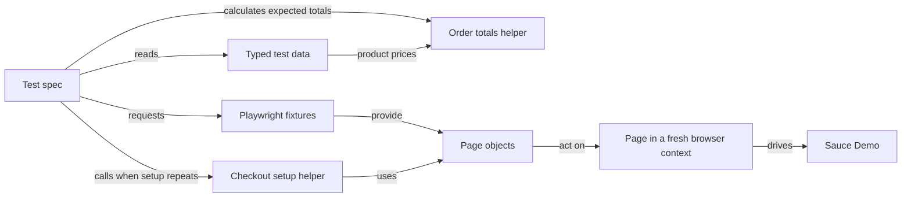

# Swag Labs E2E Tests 🛒

A Playwright + TypeScript test suite for [Sauce Demo](https://www.saucedemo.com/).
From signing in to placing an order, with a few wrong turns along the way.

## Get running 🚀

You’ll need Node.js 24, npm 11, and Yarn Classic. Both local setup and CI use the Node major in [`.nvmrc`](./.nvmrc). If you use nvm, run `nvm install` and `nvm use` first.

```bash
yarn install
yarn playwright install chromium
yarn test
```

| Want to…                        | Run                           |
| ------------------------------- | ----------------------------- |
| Check the full purchase journey | `yarn test:smoke`             |
| Focus on checkout               | `yarn test:checkout`          |
| Watch the browser               | `yarn test:headed`            |
| Step through a failure          | `yarn test:debug`             |
| Open the last HTML report       | `yarn playwright show-report` |

Use `yarn test:login`, `yarn test:inventory`, `yarn test:inventory-details`, or
`yarn test:cart` to focus on a feature. Use `yarn test:positive` or
`yarn test:negative` to filter by category. The full command list is in
[package.json](./package.json).

## What’s covered ✅

- **Sign-in and session** — valid, slow, and locked-out users, invalid credentials, and access after logout.
- **Catalog** — product details, sorting, and all three Dynamic Catalog modes.
- **Cart** — add from inventory or product details, remove items, and keep the cart after a refresh.
- **Checkout** — required fields, recovery after correcting input, price breakdown, and cart contents after cancellation.
- **Purchase smoke** — sign in, order two products, verify the order lines and totals, then check the confirmation and empty cart.

The regular suite runs on Chromium.

| Demo user                 | What it’s used for                                     |
| ------------------------- | ------------------------------------------------------ |
| `standard_user`           | Everyday shopping and the purchase smoke               |
| `locked_out_user`         | Checking that sign-in is rejected                      |
| `performance_glitch_user` | Checking that sign-in succeeds with a delayed response |
| `problem_user`            | Manual exploration of the demo’s known quirks          |

User data lives in [`users.ts`](./src/constants/users.ts).

## How it fits together 🧩



- **Specs describe the behavior.** The purchase smoke shows sign-in, cart setup, and checkout in named steps. You can see exactly what gets checked before and after pressing Finish.
- **Fixtures make the starting state explicit.** Page object fixtures share the test’s `page`. Request `loggedInInventoryPage` when the test starts after sign-in. A fresh browser context keeps cookies and cart state isolated, so specs can run alone or in parallel.
- **Page objects keep UI details in one place.** A spec can call `submitCheckoutForm` without knowing how each field is located. Playwright maps `getByTestId` to Sauce Demo’s `data-test` attributes so selectors can survive CSS changes.
- **A small helper handles repeated checkout setup.** `openCheckoutWithProducts` adds the selected products and opens the customer form. Checkout specs use it in `beforeEach` to reach the starting point for the rule they’re testing.
- **Expected totals come from test data.** The totals helper calculates subtotal, tax, and total from the selected products’ prices. The spec checks each amount against the UI, so a tax mismatch has its own failure message.

### Same checkout, different questions 🛍️

| Scenario              | Where it starts                                                        | What it proves                                                                                     |
| --------------------- | ---------------------------------------------------------------------- | -------------------------------------------------------------------------------------------------- |
| Purchase smoke        | Signed out, with sign-in performed in the test                         | The right products and amounts make it through the full journey, and the cart clears after success |
| Required-field checks | A signed-in user with a product in the cart and the checkout form open | Each missing field produces its own expected error                                                 |
| Checkout cancellation | A signed-in user at the order overview                                 | The selected product stays in the cart after cancellation                                          |

Login and checkout validation use data-driven cases. Each case appears as a separate test in the report, so you can see which input triggered the failure.

### Where things live 📁

| Folder                                                                | What you’ll find                                                      |
| --------------------------------------------------------------------- | --------------------------------------------------------------------- |
| [`tests/`](./tests/)                                                  | Feature specs and the full purchase smoke                             |
| [`src/pages/`](./src/pages/)                                          | Page objects with locators and actions                                |
| [`src/fixtures/`](./src/fixtures/)                                    | Test-scoped page objects and signed-in setup                          |
| [`src/flows/`](./src/flows/)                                          | Reusable setup across pages, including opening checkout with products |
| [`src/constants/`](./src/constants/) and [`src/utils/`](./src/utils/) | Typed test data and shared helpers, including expected order totals   |

Start with [the purchase smoke](./tests/smoke-e2e.spec.ts) for the full journey
or [the checkout spec](./tests/checkout.spec.ts) for examples of focused setup
and data-driven cases.

## CI and reports 🔍

Locally, Playwright runs tests in parallel and writes the HTML report to
`playwright-report/`.

[GitHub Actions](./.github/workflows/playwright-tests.yml) runs on PRs to
`main`, pushes to `main`, and manual runs. Type and format checks run first,
then tests run by feature with one worker per job. CI retries failures once and
records a trace on the first retry. Failed test jobs upload the HTML report
with available traces, screenshots, and videos.

When something breaks, open the report and start with the first failed step.
The smoke’s named steps help you tell whether sign-in, checkout, or the final
order check failed.

Before committing, you can run `yarn type-check` and `yarn format:check`.
